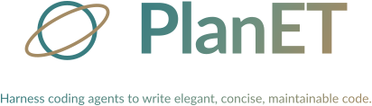
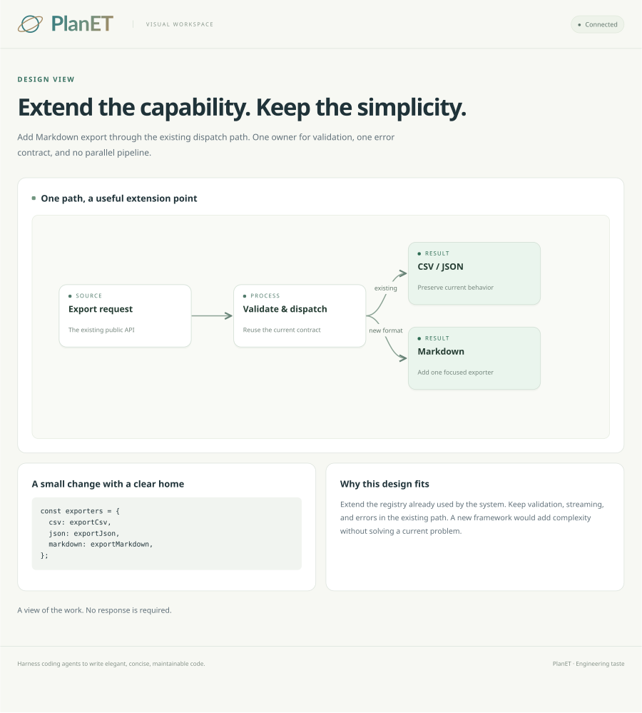
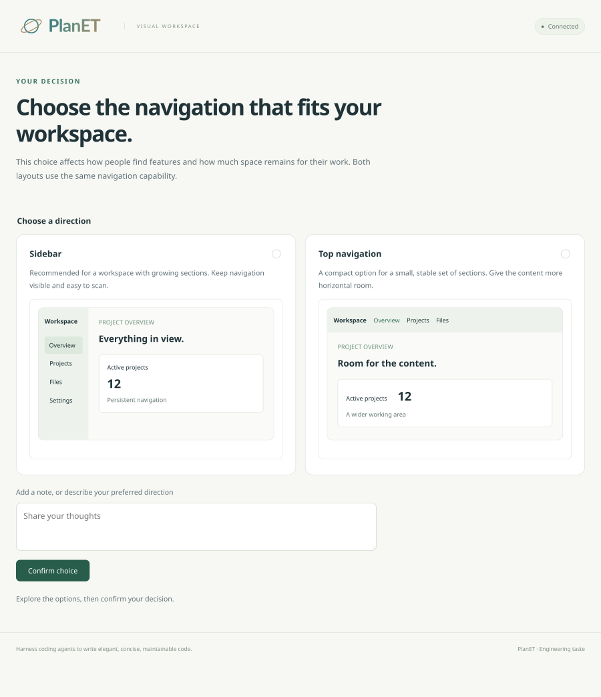

<p align="center">
  
</p>

Software development is a systems engineering discipline. Aligning requirements is essential, but it is not enough: AI-generated code can still be cluttered, overengineered, and difficult to maintain.

Tools such as Superpowers bring useful discipline to agent workflows. PlanET focuses on the engineering judgment inside that work: choosing suitable design patterns, extending existing capabilities, keeping related logic together, and removing unnecessary complexity. Agents should own routine technical decisions and ask users only necessary, consequential questions.

PlanET is an engineering harness for **Claude Code, Codex, and Pi**, delivered as a plugin with one shared set of engineering principles and an optional local visual workspace. It is designed for everyday coding: straightforward installation, ordinary task requests, and decisions that stay grounded in the existing codebase.

## Installation

Requires **Node.js 22+**, **Git**, and one of the supported coding agents. Install directly from [ecstayalive/PlanET](https://github.com/ecstayalive/PlanET); you do not need to clone the repository or run `npm install` first.

### Claude Code

Run these commands **inside a Claude Code session**:

```text
/plugin marketplace add ecstayalive/PlanET
/plugin install planet@planet
```

Start a new session after installation. [Claude Code installation reference](https://code.claude.com/docs/en/discover-plugins).

### Codex

Run these commands **in your terminal**:

```sh
codex plugin marketplace add ecstayalive/PlanET
codex plugin add planet@planet
```

Start a new session after installation. In Codex CLI, open `/hooks`, review PlanET's `SessionStart` command and trust it if acceptable. Installing or enabling the plugin does not grant hook trust; changed hook definitions require review again. If hooks are disabled or restricted by host policy, use `/skills` to select PlanET explicitly. PlanET does not alter trust settings or bypass them. [Codex hook trust](https://developers.openai.com/codex/hooks).

If your Codex version does not provide `plugin add`, update it or install PlanET from the added marketplace in the desktop client's Plugins directory. [OpenAI Docs: plugin marketplaces](https://developers.openai.com/plugins/build/plugins).

### Pi

Run this command **in your terminal**:

```sh
pi install git:github.com/ecstayalive/PlanET
```

Start a new Pi session after installation. [Pi package installation reference](https://github.com/earendil-works/pi/blob/main/packages/coding-agent/docs/packages.md).

### Use PlanET

Use your agent normally after installation. With startup loading enabled and trusted, a compact bootstrap directs the agent to read the complete PlanET policy before coding work, unless the current policy is already in active context. It does not inject the full policy into every startup prompt. You can also ask the agent to apply PlanET to an implementation, refactor, or code review. For explicit invocation:

| Agent | Engineering skill | Visual workspace |
| --- | --- | --- |
| Claude Code | `/planet:planet` | `/planet:planet-visual` |
| Codex | `/skills` → PlanET engineering skill | `/skills` → PlanET visual skill |
| Pi | `/skill:planet` | `/skill:planet-visual` |

The agent inspects existing modules, establishes clear responsibilities and interfaces, and obtains your write authorization before modifying code. When helpful, it delivers a visual companion board for layout or architecture comparison.

For example: **“Add Markdown export using the existing export pipeline.”** PlanET guides the agent to find the current implementation, define the exporter's module contract, and present the design before modifying code. To inspect the design, add **“Show how the new exporter fits into the existing flow.”**

Explicit invocation loads the same skill without needing the startup hook, provided the plugin/skill is installed and enabled. Native implicit selection can miss a relevant skill; use explicit invocation when activation matters. PlanET has no cloud backend, telemetry, or runtime dependencies. Model inference is handled by your coding agent.

After updating the installed package, start a fresh session to avoid retaining earlier policy/reference reads. Pi's `/reload` rescans installed resources and refreshes the bootstrap; it does not synchronize an unpublished checkout with the installed copy.

## Principles

1. **Choose the suitable design pattern.** Start with the existing mechanism or a direct implementation. Justify a new abstraction by the current problem it solves, not a pattern name.
2. **Keep related logic together.** Give behavior and state a clear owner. Inline meaningless private wrappers; preserve useful domain rules, boundaries, and lifecycles regardless of caller count.
3. **Extend before replacing.** Inspect existing capabilities, callers, and tests. Reuse extension points, state, and error semantics; require evidence before replacing them.
4. **Think in systems.** Trace affected inputs, outputs, state, failures, and compatibility. Check whether one plausible follow-up change would remain local, without implementing that future feature.
5. **Design first and secure write authorization.** Present a grounded design with module responsibilities and affected contracts before modifying code. Obtain explicit authorization for its scope; reuse existing approval and realign if the scope changes.
6. **Minimize trivial interruptions.** Inspect repository facts independently. Batch consequential questions with recommendations and trade-offs; use a visual companion only when seeing helps.
7. **Name things by their role.** Use domain vocabulary for actions and actual responsibilities. Preserve established public APIs, attribution, and meaningful algorithm, protocol, or version names.

The policy lives in [the PlanET skill](skills/planet/SKILL.md). Host adapters load that same policy instead of maintaining separate versions. Naming guidance does not claim to modify hidden model internals or remove upstream attribution.

The principles are language-agnostic. Your agent uses the repository's existing compiler, test runner, formatter, and conventions; PlanET provides engineering guidance rather than a language-specific toolchain.

The working sequence is **Inspect → Design → Authorize → Implement → Simplify → Verify**. Before writes, the agent replays your goal, acceptance conditions, constraints, and decisions, then explains existing capabilities/gaps, proposed owners/contracts, structural choices, verification, and write scope. Small changes need only a few sentences, not mandatory plan files or interviews. Review-only requests stay review-only.

## Code quality: CUPID and simple design

The seven principles guide the agent's actions. [Dan North's CUPID](https://dannorth.net/blog/cupid-for-joyful-coding/) describes the code properties those actions should improve:

| Property | What to inspect |
| --- | --- |
| **Composable** | Intention-revealing interfaces, necessary dependencies, and little hidden setup or ordering knowledge |
| **Unix philosophy** | A coherent purpose for callers, with related behavior kept together |
| **Predictable** | Explicit results, state changes, side effects, errors, and relevant operational limits |
| **Idiomatic** | Established language, ecosystem, and repository conventions |
| **Domain-based** | Business vocabulary, rules, and ownership that reflect the problem |

Use [Kent Beck's simple-design rules](https://martinfowler.com/bliki/BeckDesignRules.html) to resolve trade-offs: satisfy meaningful behavior tests, reveal intent, remove duplicated knowledge, then remove unnecessary elements. Fewer classes, functions, files, or lines are not independently better.

Evaluate the design and actual diff, not whether the agent names these frameworks. A plausible follow-up change helps assess maintainability: can it be made locally without copying policy or breaking existing behavior? Authorization and unnecessary questions are process measures, separate from code quality. [Design guidance](skills/planet/references/design.md) and [examples](skills/planet/references/examples.md) make these checks concrete.

## User alignment and independent evaluation

Extend existing capabilities, including unfinished features, before introducing another implementation. Replacement needs evidence that an existing limitation blocks the requested outcome, that local repair is insufficient, and that compatibility/migration is addressed. Unrelated old defects do not justify a rewrite.

The agent distinguishes your decisions from its recommendations and assumptions. Consequential outcome, contract, or scope changes return to you; corrections and rejected choices are not approval. Technical readiness and write authorization are separate judgments.

After implementation, the skill calls for a separate read-only reviewer when the host supports it and operator/project instructions permit delegation. The reviewer inspects actual code, callers, diff, user decisions, and checks using the [shared evaluation standard](skills/planet/references/evaluation.md). Each principle has evidence-based coverage ratios or violation counts with named units; missing evidence is unknown, and empty denominators are not full marks. Repeated evidence can be grouped without hiding omissions. There is no reassuring weighted total that cancels a regression or unauthorized change.

The implementing agent reconciles findings, repairs within approved scope, and obtains focused re-review. A reviewer cannot authorize writes or expand the design. When delegation is unavailable or disallowed, report that limitation; self-check is not independent review. This is a workflow instruction, not a bundled subagent runtime or a mechanical write gate.

## Evaluation in your project

PlanET applies the evaluation loop to your actual changes, not only to its own benchmark cases. Your agent uses your project's compiler, tests and static checks, maps acceptance and preserved contracts to real assertions, reviews the diff, and repairs confirmed findings within the approved scope. It reports useful coverage and material unknowns rather than a universal code-quality score. A permitted independent reviewer checks the current artifacts; later fixes need current verification and focused re-review.

An optional [evidence recorder](skills/planet/references/evidence.md) ships inside the core skill. With Node.js 22+ and Git, it snapshots the initial working tree, records explicitly authorized native commands, and flags stale check/review evidence. It works from your repository without a PlanET checkout or dependency installation; artifacts stay outside your source repository. It does not authenticate approval, enforce a sandbox or certify that model judgments are true. Without it, the same workflow uses native host evidence and discloses limitations. Small tasks need concise results, not mandatory report files.

## Skill structure and context cost

- **Startup bootstrap:** One shared loading instruction, installed policy path and SHA-256 core revision; no full engineering policy, visual instructions or reference bodies. Non-coding tasks do not need those bodies.
- **`planet`:** The unchanged complete policy is read before coding work unless its current revision is already in active context. After compaction, a summary is not a substitute for the full policy; read it again if absent. A loading failure must be reported before proceeding.
- **`planet-visual` and references:** Loaded only for their stated task conditions, not preloaded for every task. Reuse unchanged guidance already in context.

The bootstrap revision fingerprints `SKILL.md`, not references, assets or the user's source. Its stable instruction text precedes installation-specific metadata. Smaller startup bytes are not proportional token savings for a complete coding task: needed policy and references still occupy context once read. Adapter tests check a conservative startup-byte budget for this checkout, not model compliance.

## Prompt-prefix stability and caching

Claude Code and Codex receive the same deterministic bootstrap through their trusted `SessionStart` hook for startup, resume, clear and compact. The matcher accepts the supported source names rather than matching arbitrary substrings. Hook delivery and native skill activation remain host responsibilities.

Pi snapshots the bootstrap once per extension load. In current Pi, it contributes one stable `planet` system-prompt section, leaving existing sections and tools intact. Repeated turns use identical content; after compaction, the same section is restored, with instructions to reload missing full policy. Reload the extension to adopt core-policy edits.

For older Pi or a prompt forced by another extension, PlanET owns a named bootstrap block. It replaces a stale block in place and removes duplicate complete blocks, preserving surrounding text and position even when another extension follows it. Partial or similar-looking markers are not treated as complete owned blocks. Existing full-policy injections from older releases are not retroactively removed; start a fresh session after upgrading.

PlanET adds no synthetic user messages, timestamps, session IDs, task progress or screen content to the prefix. An unchanged installation and core policy produce identical bootstrap text; policy/path changes intentionally update it. Other extensions can still override a prompt, and host compaction can rewrite history.

Stable rendered prefixes are necessary, not sufficient, for cache reuse. Model eligibility, cache lifetime, routing, tool schemas, request settings and host-managed cache boundaries also matter. PlanET does not override provider parameters or pad prompts to reach a cache threshold. Measure actual cache-read tokens and input tokens from native host/provider usage over comparable runs, including cold starts; never infer a hit percentage from adapter tests or byte savings. See [OpenAI prompt caching](https://developers.openai.com/api/docs/guides/prompt-caching) and [Claude prompt caching](https://platform.claude.com/docs/en/build-with-claude/prompt-caching).

## Visual workspace

The visual workspace is a lightweight companion board, not a browser-based IDE or diagram editor. PlanET provides an optional [style template](skills/planet-visual/assets/style-template.html) and local display/confirmation infrastructure, not a prescribed content layout. The agent chooses authored HTML, concrete examples, architecture/data-flow diagrams, or comparisons according to what helps you understand the implementation. The native flowchart renderer is optional; HTML/SVG can express structures it cannot. Detailed discussion, code review, and editing stay in conversation, terminal, or native IDE. Screens distinguish **views** from **decisions**:

- A **view** explains a design or shows a result while authorized work continues. The example below maps the existing export path and its Markdown extension, with the proposed implementation and design rationale alongside it.



- A **decision** requests a consequential choice or scoped write approval. Review the alternatives, then explicitly submit your direction or feedback. The example below compares two navigation layouts. Neither option is preselected. A request to revise or a rejection does not grant write authorization.



Ask the agent to show a design or comparison, then open the local link it shares. The agent prepares and updates the visual workspace. A view needs no reply. For a decision, review the alternatives, confirm your choice, and return to the conversation to continue.

The workspace runs locally and supports agent-authored static HTML/SVG, examples, read-only code previews with file/symbol context, and written feedback. The style template contains presentation styles only; content and layout remain the agent's choice. Scripts and remote assets remain disabled in preview frames. Request adjustments in conversation; the agent updates the board. Submitted responses survive refresh, but do not automatically start an agent turn or imply approval. Only explicit approval of the presented design grants scoped write authorization, not permission to commit, push, deploy, or expand scope. Without a local browser, use conversation or a static preview.

## Identity and terminal display

The identity pairs a simple orbital mark with the **PlanET** wordmark. The name and capitalization carry the identity even when color and graphics are unavailable. All image assets are SVG. The README centers a self-contained, transparent SVG banner with a tightly fitted canvas. Terminal output uses text or a tiled wordmark.

- [Light logo](skills/planet-visual/public/logo.svg), [dark logo](assets/logo-dark.svg), and [monochrome logo](assets/logo-mono.svg).
- [Standalone icon](assets/icon.svg) and [monochrome icon](assets/icon-mono.svg).
- [Brand guide and preview](assets/README.md).

```sh
node scripts/logo.mjs                 # Compact wordmark; color on a capable TTY
node scripts/logo.mjs --banner        # Optional seven-row color-block banner
node scripts/logo.mjs --no-color      # Plain text
node scripts/logo.mjs --color         # Explicit ANSI color for a preview
```

The renderer respects `NO_COLOR`, `TERM=dumb`, redirected output, and narrow TTYs. True-color terminals use a coordinated three-color palette; 256-color and basic ANSI terminals receive the closest available treatment. Colored banners use background-colored spaces; without color, solid Unicode blocks preserve the letterforms. Dumb terminals use plain `PlanET`. No special font or image protocol is required. Display is opt-in and never enters agent prompts or startup output.

## Development and verification

Clone the repository:

```sh
git clone https://github.com/ecstayalive/PlanET.git
cd PlanET
```

Try the checkout for one session with `claude --plugin-dir .` or `pi -e .`. For Codex, use `codex plugin marketplace add .`, then `codex plugin add planet@planet` and start a new session.

To use only the skills, copy the complete `skills/planet` and `skills/planet-visual` directories into your agent's skills directory. This does not install the startup adapters; standalone Codex names are `$planet` and `$planet-visual`.

No `npm install` is needed. Run the checks:

```sh
npm run check
npm test
claude plugin validate --strict .claude-plugin/plugin.json
claude plugin validate --strict .claude-plugin/marketplace.json
```

Checks cover package metadata, skill references, script syntax, host adapters, visual protocol invariants, and the evidence recorder's behavior against temporary user repositories. These tests do not evaluate generated application code. [Behavioral evaluations](evals/README.md) separately compare no-skill, current-skill, and candidate-skill runs using the design, actual diff, behavior tests, and selected follow-up changes. The cases are an evaluation design, not reported model results: a valid package does not prove the model will follow its instructions or produce maintainable code.
